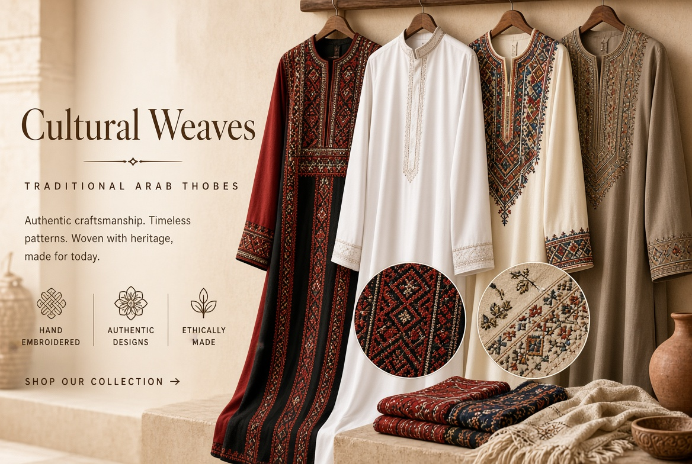
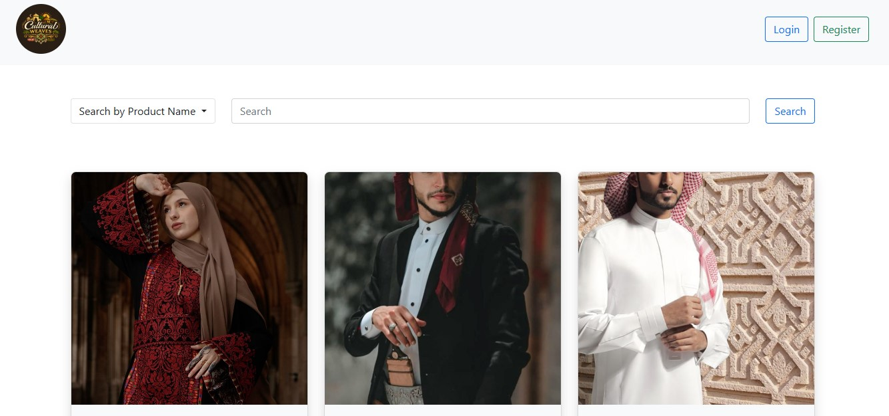

<p align="center">
  
</p>

# 🧵 Cultural Weaves

A responsive e-commerce website for Palestinian cultural products, with user authentication, product search, and a shopping cart. Built with HTML5, CSS3, Bootstrap, and JavaScript.

🔗 **Live Demo:** [dev-ahmedissa.github.io/cultural-waves](https://dev-ahmedissa.github.io/cultural-waves/)

## 📸 Preview



## ✨ Features

- Fully responsive layout that adapts to mobile, tablet, and desktop screens
- User registration and login pages
- Product listing with prices
- Search products by name or by category
- Shopping cart with an items counter and an "Add to Cart" button
- Page to view all cart products
- Logout functionality

## 🛠️ Built With

- HTML5
- CSS3
- Bootstrap
- JavaScript

## 🚀 Run Locally

```bash
git clone https://github.com/dev-ahmedissa/cultural-waves.git
cd cultural-waves
```

Then open `index.html` in your browser.

## 📬 Contact

**Ahmed Issa**, Frontend Developer
[ahmednashatissa@gmail.com](mailto:ahmednashatissa@gmail.com) • [GitHub](https://github.com/dev-ahmedissa)
